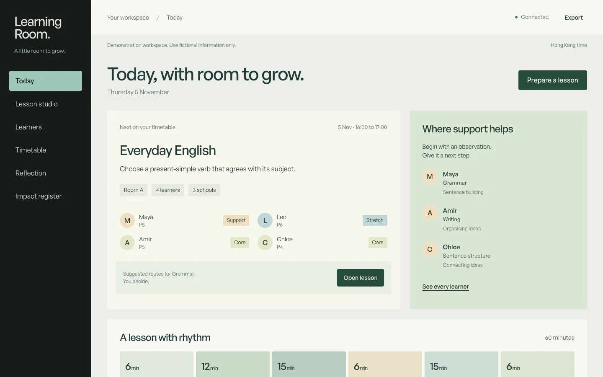

# Learning Room

Source code from the learning-centre prototype shared in **Living and building in the AI era**, CUHK LDTE 3120, on 5 November 2026.

[Try the live demo](https://orbiting0314.github.io/learning-room-platform/#/) · [Read the classroom prompt](docs/classroom-prompt.md) · [Fork the project](https://github.com/Orbiting0314/learning-room-platform/fork)



## A note from Thomas

Thank you for joining the session and for the questions afterwards. Several of you asked for the code, so I am sharing it here for you to explore, change and build on.

You do not need to understand the whole application before you begin. Pick one activity, change an instruction, try a different feedback message, or add a question of your own. Run it, see what happens and ask someone to try it. Each small experiment gives you something concrete to learn from.

The habits I hope you take away are to understand the people you are building for, make the next step small enough to finish, and check whether your work actually helps. Keep asking questions and keep making things. I would be glad to hear what you try.

**Thomas Pang**, co-founder of KERN Design Studio

## About KERN Design Studio

[KERN Design Studio (KDS)](https://kerndesignstudio.me/) is a Hong Kong digital studio. We build custom websites and business systems, and use AI to help turn ideas into practical software.

Our work starts with understanding a real problem, then shaping an idea into something people can try, review and improve. Our aim is to make technology accessible to more people, including those who do not come from a technical background.

## About this example

Learning Room connects lesson preparation, different learner needs, teacher reflection and class planning in one small application. Its English examples are designed for P4 to P6 learners.

The application was developed with AI assistance. **I set up the harness used for this demonstration myself. Its private configuration is not included in the shared materials.** This repository contains the application source and tests for you to study and adapt.

The [classroom prompt](docs/classroom-prompt.md) shares the product-focused brief. Use it to explore how a problem description becomes features, workflows and checks. The [product plan](docs/product-plan.md) explains the educational, environmental, social and economic questions behind the prototype.

## Run it on your computer

Install **Node.js 24 or later** from [nodejs.org](https://nodejs.org/). You do not need a paid AI account, API key or cloud account to run the local application.

```sh
git clone https://github.com/Orbiting0314/learning-room-platform.git
cd learning-room-platform
npm start
```

Open **http://127.0.0.1:8788/** while the terminal stays open. Press **Ctrl+C** in that terminal to stop it. If you prefer, use GitHub's **Code**, then **Download ZIP**, extract the folder and run `npm start` inside it.

The application itself has no runtime packages to install. Its local server serves the interface and stores demonstration work in a local SQLite file. Your local copy is separate from the online demo.

Use fictional information while experimenting. This is a teaching prototype; a real learner service needs the institutional arrangements described in the product plan.

## What you can explore

- Adapt a shared learning objective with Support, Core and Stretch instructions.
- Preview learner practice, check core answers and review writing with a rubric.
- Award optional challenge marks separately from core learning evidence.
- Print learner activities without the teacher's private notes or answer feedback.
- Record observations across grammar, sentence structure, writing, listening and reading.
- Plan classes around learner availability, teachers, rooms, capacity and changeover time.
- Keep evidence about printing, preparation time, community places and reported neighbour incidents.

All starting learners, schools, classes and observations are fictional. The impact register starts without measured results; funding, endorsement and educational effectiveness have not been established by this demo.

## Find your way around the code

| File or folder | What to look for |
| --- | --- |
| [public/content.js](public/content.js) | The original sample activities, feedback and learning routes. A useful first place to experiment. |
| [public/app.js](public/app.js) | The interface and the teacher and learner workflows. |
| [public/styles.css](public/styles.css) | Layout, colours, responsive behaviour and control states. |
| [server/domain.mjs](server/domain.mjs) | Rules for lessons, observations, bonus marks and class planning. |
| [server/index.mjs](server/index.mjs) | The application service and local data storage. |
| [tests/](tests/) | Examples of checking expected behaviour and difficult cases. |
| [docs/classroom-prompt.md](docs/classroom-prompt.md) | The product-focused classroom brief and questions to consider. |

## A few experiments to try

1. Add a new activity with one clear learning objective and a useful explanation for each answer.
2. Adapt a task for a different learner group. Explain why you changed the support.
3. Improve one interaction for someone using a keyboard or a small screen.
4. Add a class-planning rule, then write a test for a booking that should be rejected.
5. Ask a teacher or classmate to try your version. Use what you observe to decide the next change.

Keep examples fictional and review the suitability of teaching content before using it with learners.

## Check your changes

These commands need only Node.js:

```sh
npm test
npm run check
npm run build
```

The optional browser checks use the public [Playwright](https://playwright.dev/) package. Keep `npm start` running in one terminal, then use another terminal:

```sh
npm ci
npx playwright install chromium
npm run test:browser
```

Browser checks create and remove only their own fictional test workspace. They do not require the private harness used to develop the original demo.

For an independent hosted version, see [the development notes](docs/development.md). Local use does not require deployment.

## Use it, change it and share it

The original application code, teaching samples and documentation are shared under the [MIT License](LICENSE). You are welcome to fork the repository, experiment, build your own version and share what you learn. Keep the license notice with copies of the code.

See [third-party notices](THIRD_PARTY_NOTICES.md) for the optional font and project identity. The original font files are obtained separately from their publisher and are not included in this source release.

If you would like to suggest an improvement, see [CONTRIBUTING.md](CONTRIBUTING.md).

## Stay in touch

If you are interested in AI, product building, education technology, or want to show me something you have made, feel free to connect:

- **LinkedIn:** [Thomas Pang](https://www.linkedin.com/in/thomas-pang-501486262/)
- **GitHub:** [Orbiting0314](https://github.com/Orbiting0314)
- **Instagram:** [KDS @kerndesignstudio.ai](https://www.instagram.com/kerndesignstudio.ai/)
- **Email Thomas via KDS:** [info@kerndesignstudio.me](mailto:info@kerndesignstudio.me?subject=CUHK%20Learning%20Room)
- **KERN Design Studio:** [kerndesignstudio.me](https://kerndesignstudio.me/)

Bring an idea, a prototype or a question. You can start with one small thing.
